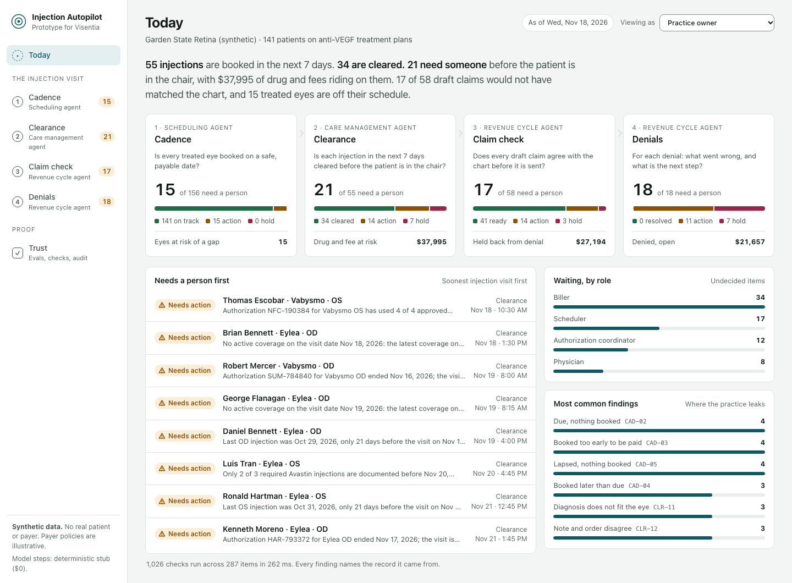
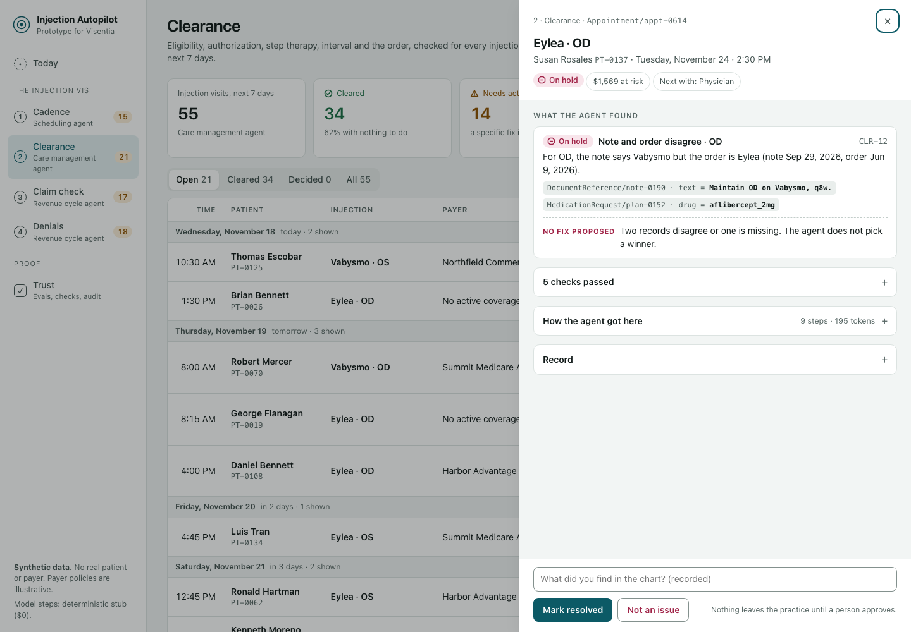
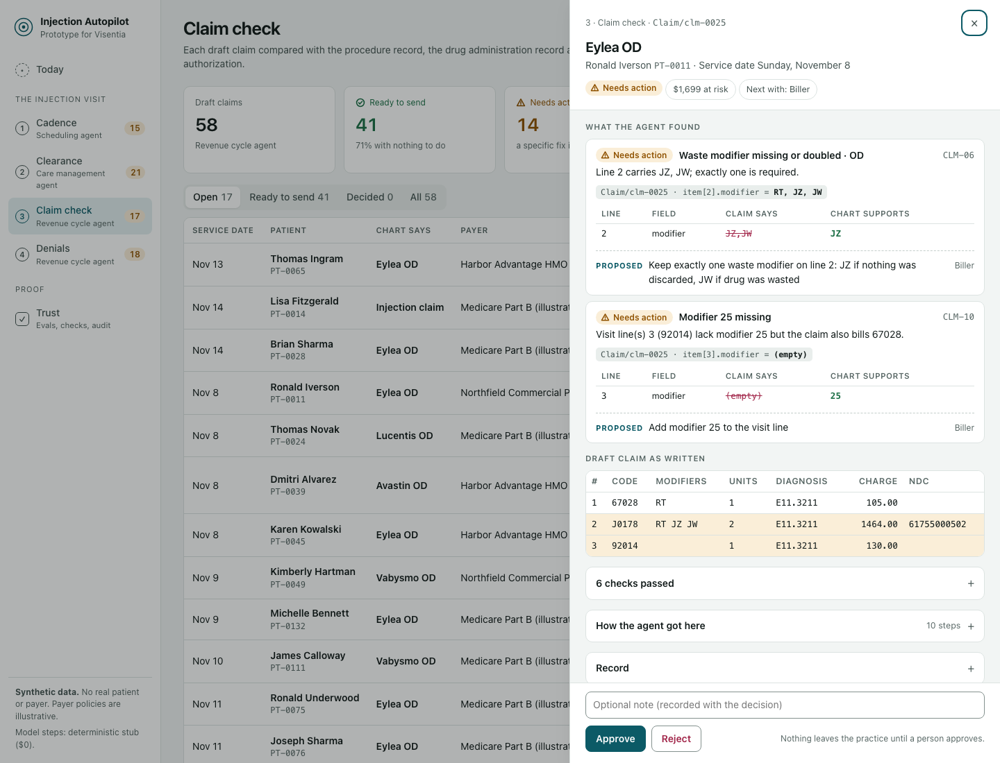

# Injection Autopilot

A prototype for Visentia. It follows every anti-VEGF injection visit in a retina practice through four checkpoints
and tells the right person what to do before the patient is in the chair and before the claim goes out.

| Checkpoint | Visentia roadmap agent | Question it answers | Works for |
|---|---|---|---|
| 1 Cadence | Scheduling agent ("optimized for injection cadences") | Is every treated eye booked on a safe, payable date? | Scheduler |
| 2 Clearance | Care management agent (prior authorization, insurance verification) | Is each injection in the next 7 days cleared? | Authorization coordinator |
| 3 Claim check | RCM agent (claims) | Does the draft claim agree with the chart? | Biller |
| 4 Denials | RCM agent ("denials autopilot") | What went wrong, and is it a corrected claim or an appeal? | Biller |

**All data is synthetic.** No real patient, payer or claim. The four payer policies are written for the prototype.



## Run
Needs Python 3 (tested on 3.13). No database, no build step, no API key.
```bash
git clone https://github.com/madhavrajk/Injection-Autopilot.git && cd Injection-Autopilot
python3 -m venv .venv && source .venv/bin/activate && pip install -r requirements.txt
python -m app.synth                  # optional: regenerates the seeded synthetic FHIR bundle (already committed)
python scripts/gate.py               # tests, blind cases, full check: must end with VERDICT: PASS (about 40 s)
uvicorn app.api:app --port 8765      # then open http://localhost:8765
```
In the app, switch roles (owner, scheduler, authorization coordinator, biller, physician, compliance) to see each queue; open any
item for its evidence, its trace and the approve / edit / reject controls. For a guided tour with screenshots, open
`docs/walkthrough.html` in a browser. The screenshots are also in `docs/screens/`.
No API key is needed. With `ANTHROPIC_API_KEY` set, the two model steps call a live model under a budget guard
(`AUTOPILOT_BUDGET_USD`, default $1); without it a deterministic stub runs and everything costs $0.

## How it works
```
FHIR R4 bundle (Patient, Coverage, MedicationRequest, Procedure, MedicationAdministration,
                Appointment, DocumentReference, Claim, ClaimResponse) + versioned payer policies
   │ code   ingest: validate, flag, never repair
   ▼
 rules (code): cadence · clearance · claim check · denial triage ──► checks, each citing the record it read
   │ model  reads the plan sentence in the clinic note (identifiers removed first)
   │ code   compares it with the structured order; a disagreement is a hold
   │ model  writes letter wording as a template; code fills every fact and fact-checks the template
   ▼
 work items: clear · needs action (a specific fix is proposed) · on hold (sources disagree, no fix proposed)
   │ person approve / edit / reject ──► append-only decision log ──► candidate eval cases
   ▼
 API (FastAPI, names masked by role on the server) ──► one-page interface

 verify (separate reader of the raw bundle): every field · every evidence row · every item vs the answer key · leak scan
```

| A hold: the note and the order name different drugs, so the agent proposes nothing | A claim fix: each proposed change cites the record it came from |
|---|---|
|  |  |

## Choices, and why
| Choice | Why |
|---|---|
| **The injection visit is the unit of work** | Eye, drug, payer and date decide all four checkpoints. Vendors exist for each checkpoint; none found joins them (`docs/research.md`) |
| **Rules in code, a model only for language** | A date subtraction that is always right costs nothing. The model reads note wording and writes letter wording, and never writes an eye, drug, dose, date or number |
| **Disagreement is a hold, not a guess** | If the procedure record says OD and the drug record says OS, choosing one is a clinical decision. The agent stops and says so |
| **Overflag, and show what passed** | A miss costs a drug claim or a treatment gap; a false alarm costs a minute. "Cleared" lists every check that passed |
| **Payer policy is versioned data** | Bevacizumab coding and interval edits differ by payer and change without notice (`docs/domain_recon.md`) |
| **Letters are templates** | The model's prompt holds the letter type and the fact names only. No PHI goes to a model for drafting, and a draft with a digit, drug or eye outside a placeholder cannot be approved |

## Results (seed 7, as of 2026-11-18)
| Check | Result |
|---|---|
| World | 141 patients · 156 treated eyes · 55 injection visits in 7 days · 58 draft claims · 18 denials · 287 work items |
| Unit tests | 210 passing, offline, $0 |
| Blind labelled cases (written from the spec alone, without the implementation) | 52/52 · 0 wrong clears · 0 false alarms on 18 near misses |
| Answer key, every item (the generator recorded its 71 planted defects) | 287/287 match · 0 missed · 0 clean items flagged |
| Second-source check (separate reader of the raw bundle) | 2,729 records · 16,092 fields · 0 mismatches |
| Evidence | 1,581 rows, each traced to a record and its value |
| Leak check | 73 prompts and 1,673 trace steps scanned for 1,127 identifiers · 0 found |
| Fault injection | flipped eye, corrupted evidence, a name in a prompt, edited answer key: each one is caught |
| What the app shows | 21 of 55 visits need a person ($37,995 of drug and fees) · 17 of 58 claims did not match the chart ($27,194) · 15 eyes off schedule |

One real defect was found by the full check, not by the tests: a finding cited `productOrService = "none"`, a value
that is in no record. It became a test, then a fix (`docs/rationale.md`).

## How it was built
Contracts (`app/contracts.py`) and the rule spec (`docs/spec.md`) came first, then the modules against them, then
checks that are independent of the implementation: labelled cases written from the spec alone, a verifier that re-reads
the raw bundle separately, and an answer key from the data generator. The interface and a review pass came last.
Questions and assumptions: `docs/questions.md`. Decisions: `docs/rationale.md`. Pass/fail criteria: `docs/criteria.md`.

## Limits
- Synthetic data. The clinic notes follow a known grammar, so the note reader looks better here than it would on real
  dictation. The blind cases and the answer key test the rules, not clinical validity.
- Billing rules come from public sources with mixed confidence (`docs/domain_recon.md`); the ICD-10 table has ten
  codes; modifier 50, biosimilars, complement inhibitors and wastage units are not modelled.
- The model steps ran on the stub. The live path exists and is untested against a real model; the prices in
  `app/llm.py` are placeholders.
- "Approve" records a decision. It does not submit to a payer, change an appointment or edit a claim.
- Dollar figures use illustrative allowed amounts. No sign-in: the role switch is a demo control.
- The proof is self-generated: this build wrote the data, the answer key and the rules. It shows the engine does what
  the spec says, not that the spec matches a real practice.
- Step therapy has no established-patient exemption and still runs when an authorization is already approved, which
  would overflag a real Medicare Advantage book. A lapsed eye shows no dollar figure.

## Reviews (once each, at the end)
| Review | Result |
|---|---|
| Panel (`docs/panel.md`): biller, data engineer and HIPAA reviewer, product lead | 10 of 10 criteria pass · no blockers · scores 6, 6, 7 |
| Design (`docs/ux_review.md`): independent designer | owner 7 · queue 6 · trust 8 · craft 7 · accessibility 6, before one round of fixes |
| Fixed after review | urgent list order, clipped column, 12-hour times, one name per state, contrast (4.1 to 5.0), per-payer appeal windows, waste-modifier wording, no role means no names |
| Left open | step-therapy exemption, real sign-in, a replay on a practice's de-identified claims |

## Next steps
1. Connect one real source: ModMed or Nextech appointments and procedures, read-only, into the same `Dataset`.
2. Run the note reader on de-identified real notes with a clinician-labelled set; decide if it stays a cross-check.
3. Eligibility (270/271) and authorization status from a clearinghouse; payer authorization APIs as CMS-0057-F lands.
4. Drug inventory: is the vial for tomorrow's cleared injections on the shelf (the buy-and-bill cash side).
5. Push the queues where staff work: a morning summary in Teams or Slack, and the patient text from the outreach draft.
